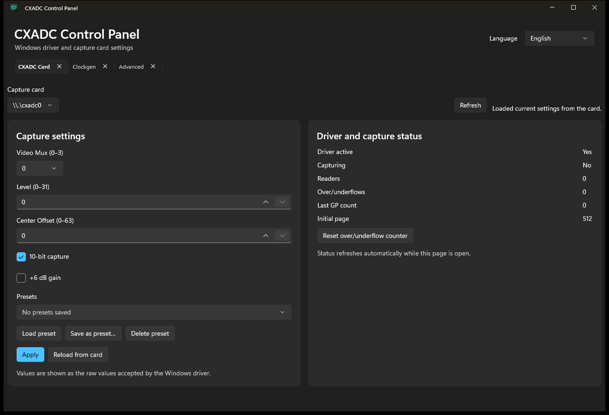

# CXADC Tools / Ferramentas CXADC

[English](#english) · [Português brasileiro](#português-brasileiro)

<a id="english"></a>
## English

**CXADC Tools** bundles the experimental Windows `cxadc-win` driver, its PowerShell and capture utilities, optional Clockgen firmware, and the **CXADC Control Panel**. The panel is a WinUI 3 desktop app for configuring the CXADC card and compatible Clockgen devices.

This is a Windows port of the [Linux cxadc driver](https://github.com/happycube/cxadc-linux3) for Conexant CX2388x chips used by PCI TV tuner and capture cards. The project is intended for analog video capture workflows such as [vhs-decode](https://github.com/oyvindln/vhs-decode). More information about supported cards is available in the [CX Cards guide](https://github.com/oyvindln/vhs-decode/wiki/CX-Cards).

> [!WARNING]
> This software and driver are experimental and provided without warranty. The driver is unsigned. Windows security policy may prevent it from loading; consult the driver documentation and your Windows version's requirements before installation. The installer does **not** change Secure Boot, test-signing, or driver-signature settings. Use at your own risk.

### Download and install

Download the latest package from the [releases page](https://github.com/Samuelzin-jgs/cxadc-win-gui/releases). When a `CXADC-Tools-Setup.exe` installer is provided, it installs the panel and utilities, then asks Windows to install the driver. You can also download the driver and tools separately from the release archive.

The installer may need administrator privileges. If Windows rejects the unsigned driver, the panel and other tools can still be installed; follow the driver-specific instructions for your system rather than changing security settings blindly.

The driver step reports what actually happened: whether the driver package reached the Windows driver store and whether a CXADC card is present and started. Select **Clean driver install** in the installer's task list to remove existing `cxadc-win` driver packages before reinstalling; that option is off by default and only touches packages whose original INF is `cxadc-win.inf`.

### CXADC Control Panel



The panel provides three areas:

- **CXADC card:** read and apply Video Mux (`0–3`), Level (`0–31`), Center Offset (`0–63`), 10-bit capture, and +6 dB gain; view the driver's status and reset its over/underflow counter.
- **Clockgen:** detect a compatible device and read its serial number, firmware version, current rates, and supported rate options from the device. Clock 0, Clock 1, and ADC choices are discovered at runtime.
- **Advanced:** read and write bounded hardware registers and inspect or change EEPROM function flags. EEPROM writes can make a card unusable; use them only when you understand the effect.

The panel supports English and Brazilian Portuguese. CXADC settings are shown in the driver's raw value ranges; the app does not apply an assumed signed Center Offset conversion.

On first launch the panel asks for the language and stores the choice, together with your card presets, in `%LOCALAPPDATA%\CXADC Tools\settings.json`. Presets save Video Mux, Level, Center Offset, 10-bit, +6 dB and the Clockgen rates; loading a preset only fills the fields, so press **Apply** to send it to the card.

### Driver settings

| Setting | PowerShell / WMI property | Values | Default |
| --- | --- | ---: | ---: |
| Video mux | `VideoMux` (`vmux`) | `0–3` | `2` |
| Level | `Level` (`level`) | `0–31` | `16` |
| Center offset | `CenterOffset` (`center_offset`) | `0–63` | `0` |
| 10-bit capture | `EnableTenbit` (`tenbit`) | On / Off | Off |
| +6 dB gain | `EnableSixDB` (`sixdb`) | On / Off | Off |

For details about the signal parameters, see the [Linux cxadc documentation](https://github.com/happycube/cxadc-linux3).

### PowerShell configuration

The panel is optional; the driver can also be managed through the included PowerShell module and WMI. Import the module from the extracted tools directory:

```powershell
Import-Module .\CxadcWin.psm1
Get-CxadcWinDevice
Get-CxadcWinConfig -Path \\.\cxadc0
Get-CxadcWinState -Path \\.\cxadc0
Set-CxadcWinConfig -Path \\.\cxadc0 -VideoMux 1
```

PowerShell 7.4 or later may be required for the included scripts. See `Get-Help .\CxadcWin.psm1 -Full` for the available commands.

### Clockgen and capture

Clockgen support is optional. A Windows-compatible firmware build and its instructions are included with releases when available; see [`src/clockgen`](src/clockgen/README.md). The panel can inspect firmware version and configure supported clock and ADC rates. It does not update firmware.

`LocalCapture.ps1` is a Windows capture-server utility. Its dependencies and parameters are documented in the script's help and the [capture-server README](src/capture-server/README.md). Depending on the workflow, it can capture CXADC video, a second card's Hi-Fi audio, and Clockgen baseband audio, with optional compression and conversion. **10-bit capture is not supported by `LocalCapture.ps1`.**

Example, capturing from one card:

```powershell
.\LocalCapture.ps1 -Name TestCapture -Video 0 -CompressVideo -VideoBaseRate 28636
```

See [Other tools](#other-tools) for cxcvbs and GNU Radio information.

### Build the control panel

Requirements: Windows, .NET 10 SDK, and access to NuGet packages. From the repository root:

```powershell
dotnet publish .\src\Cxadc.ControlPanel\Cxadc.ControlPanel.csproj `
  --configuration Release --runtime win-x64 --self-contained true `
  -p:WindowsAppSDKSelfContained=true -p:PublishTrimmed=false `
  -p:PublishReadyToRun=false -p:Platform=x64 `
  --output .\publish\cxadc-control-panel
```

The output includes the .NET and Windows App SDK runtime, so users do not need to install those runtimes separately. The GitHub Actions release workflow can build the panel and package the combined tools installer.

### Other tools

- [cxcvbs](https://github.com/JuniorIsAJitterbug/cxcvbs): CVBS viewer for use with this driver.
- [GNU Radio example flowgraphs](https://github.com/tandersn/GNRC-Flowgraphs/tree/main/test_cxadc): sample CXADC workflows. The Windows Video SDL Sink may have issues; see [this discussion](https://lists.gnu.org/archive/html/discuss-gnuradio/2024-11/msg00031.html).

### Building the driver

The driver build has been tested with Visual Studio 2022 and Windows SDK/WDK 10.0.26100. See the driver project files and workflow for build details.

### Credits

Based on the [Linux cxadc driver](https://github.com/happycube/cxadc-linux3). Thanks to the Domesday86 community for testing and support. The Windows driver and related upstream tools retain their respective licenses; see the included license files.

### How this was built

This fork is **vibecoded**: the Control Panel, the installer changes and the CI workflows were written by an AI coding agent working from the upstream project, with the maintainer reviewing and testing each change. Treat it as experimental software, read the diffs, and test on your own hardware before relying on it.

---

<a id="português-brasileiro"></a>
## Português brasileiro

**CXADC Tools** reúne o driver experimental `cxadc-win` para Windows, utilitários de PowerShell e captura, firmware opcional para Clockgen e o **CXADC Control Panel**. O painel é um aplicativo desktop em WinUI 3 para configurar placas CXADC e dispositivos Clockgen compatíveis.

Este projeto é uma versão para Windows do [driver cxadc para Linux](https://github.com/happycube/cxadc-linux3), destinado aos chips Conexant CX2388x encontrados em placas PCI de TV e captura. O projeto atende a fluxos de captura de vídeo analógico, como o [vhs-decode](https://github.com/oyvindln/vhs-decode). Consulte o guia [CX Cards](https://github.com/oyvindln/vhs-decode/wiki/CX-Cards) para mais informações sobre as placas.

> [!WARNING]
> Este software e o driver são experimentais e fornecidos sem garantia. O driver não tem assinatura. As políticas de segurança do Windows podem impedir seu carregamento; consulte a documentação do driver e os requisitos da sua versão do Windows antes de instalar. O instalador **não** altera Secure Boot, test signing nem as configurações de assinatura de drivers. O uso é por sua conta e risco.

### Download e instalação

Baixe o pacote mais recente na [página de releases](https://github.com/Samuelzin-jgs/cxadc-win-gui/releases). Quando o instalador `CXADC-Tools-Setup.exe` estiver disponível, ele instala o painel e os utilitários e, em seguida, solicita ao Windows a instalação do driver. Também é possível baixar separadamente o driver e as ferramentas no arquivo da release.

O instalador pode exigir privilégios de administrador. Se o Windows rejeitar o driver sem assinatura, o painel e as outras ferramentas ainda poderão ser instalados. Siga as instruções específicas do driver para o seu sistema; não altere as configurações de segurança sem entender as consequências.

A etapa do driver informa o que realmente aconteceu: se o pacote chegou ao repositório de drivers do Windows e se há uma placa CXADC presente e iniciada. Marque **Instalação limpa do driver** na lista de tarefas do instalador para remover os pacotes `cxadc-win` existentes antes de reinstalar; a opção vem desmarcada e só afeta pacotes cujo INF original é `cxadc-win.inf`.

### CXADC Control Panel


O painel oferece três áreas:

- **Placa CXADC:** consultar e aplicar Video Mux (`0–3`), Level (`0–31`), Center Offset (`0–63`), captura de 10 bits e ganho de +6 dB; visualizar o estado do driver e zerar o contador de over/underflow.
- **Clockgen:** detectar um dispositivo compatível e consultar seu número de série, versão do firmware, frequências atuais e opções suportadas. As opções de Clock 0, Clock 1 e ADC são lidas do dispositivo em tempo de execução.
- **Avançado:** ler e gravar registradores dentro dos limites permitidos e consultar ou alterar flags de funções na EEPROM. Uma gravação na EEPROM pode inutilizar a placa; use esse recurso somente se entender o efeito.

O painel oferece português brasileiro e inglês. As configurações CXADC são exibidas nos intervalos brutos do driver; o aplicativo não presume uma conversão assinada para Center Offset.

Na primeira abertura o painel pede o idioma e guarda a escolha, junto com os presets da placa, em `%LOCALAPPDATA%\CXADC Tools\settings.json`. Os presets salvam Video Mux, Level, Center Offset, 10 bits, +6 dB e as frequências do Clockgen; carregar um preset apenas preenche os campos, então clique em **Aplicar** para enviar à placa.

### Parâmetros do driver

| Parâmetro | Propriedade PowerShell / WMI | Valores | Padrão |
| --- | --- | ---: | ---: |
| Video mux | `VideoMux` (`vmux`) | `0–3` | `2` |
| Level | `Level` (`level`) | `0–31` | `16` |
| Center offset | `CenterOffset` (`center_offset`) | `0–63` | `0` |
| Captura de 10 bits | `EnableTenbit` (`tenbit`) | Ligado / Desligado | Desligado |
| Ganho +6 dB | `EnableSixDB` (`sixdb`) | Ligado / Desligado | Desligado |

Para entender os parâmetros de sinal, consulte a [documentação do cxadc para Linux](https://github.com/happycube/cxadc-linux3).

### Configuração pelo PowerShell

O painel é opcional: também é possível gerenciar o driver pelo módulo PowerShell incluído e por WMI. Importe o módulo na pasta onde as ferramentas foram extraídas:

```powershell
Import-Module .\CxadcWin.psm1
Get-CxadcWinDevice
Get-CxadcWinConfig -Path \\.\cxadc0
Get-CxadcWinState -Path \\.\cxadc0
Set-CxadcWinConfig -Path \\.\cxadc0 -VideoMux 1
```

Os scripts incluídos podem exigir PowerShell 7.4 ou posterior. Consulte `Get-Help .\CxadcWin.psm1 -Full` para ver os comandos disponíveis.

### Clockgen e captura

O suporte a Clockgen é opcional. Quando disponível, as releases incluem firmware compatível com Windows e instruções em [`src/clockgen`](src/clockgen/README.md). O painel consulta a versão do firmware e configura as frequências de clock e ADC suportadas. Ele não atualiza o firmware.

`LocalCapture.ps1` é um utilitário de captura para Windows. Dependências e parâmetros estão na ajuda do script e no [README do capture-server](src/capture-server/README.md). Conforme o fluxo, ele captura vídeo CXADC, áudio Hi-Fi de uma segunda placa e áudio baseband via Clockgen, com opções de compressão e conversão. **O `LocalCapture.ps1` não oferece suporte à captura de 10 bits.**

Exemplo de captura com uma placa:

```powershell
.\LocalCapture.ps1 -Name TestCapture -Video 0 -CompressVideo -VideoBaseRate 28636
```

Consulte [Outras ferramentas](#outras-ferramentas) para informações sobre cxcvbs e GNU Radio.

### Compilar o painel

Requisitos: Windows, .NET 10 SDK e acesso aos pacotes NuGet. Na raiz do repositório:

```powershell
dotnet publish .\src\Cxadc.ControlPanel\Cxadc.ControlPanel.csproj `
  --configuration Release --runtime win-x64 --self-contained true `
  -p:WindowsAppSDKSelfContained=true -p:PublishTrimmed=false `
  -p:PublishReadyToRun=false -p:Platform=x64 `
  --output .\publish\cxadc-control-panel
```

A saída inclui os runtimes do .NET e do Windows App SDK; os usuários não precisam instalá-los separadamente. O workflow de releases do GitHub Actions pode compilar o painel e montar o instalador com as ferramentas.

### Outras ferramentas

- [cxcvbs](https://github.com/JuniorIsAJitterbug/cxcvbs): visualizador CVBS compatível com este driver.
- [Exemplos de fluxos GNU Radio](https://github.com/tandersn/GNRC-Flowgraphs/tree/main/test_cxadc): exemplos de uso do CXADC. O Video SDL Sink pode apresentar problemas no Windows; veja [esta discussão](https://lists.gnu.org/archive/html/discuss-gnuradio/2024-11/msg00031.html).

### Compilar o driver

A compilação do driver foi testada com Visual Studio 2022 e Windows SDK/WDK 10.0.26100. Consulte os arquivos do projeto do driver e o workflow para detalhes.

### Créditos

Baseado no [driver cxadc para Linux](https://github.com/happycube/cxadc-linux3). Agradecemos à comunidade Domesday86 pelos testes e apoio. O driver para Windows e as ferramentas relacionadas mantêm suas respectivas licenças; consulte os arquivos de licença incluídos.

### Como isto foi feito

Este fork é **vibecodado**: o Control Panel, as mudanças no instalador e os workflows de CI foram escritos por um agente de código de IA a partir do projeto original, com o mantenedor revisando e testando cada mudança. Trate como software experimental, leia os diffs e teste no seu próprio hardware antes de confiar nele.
